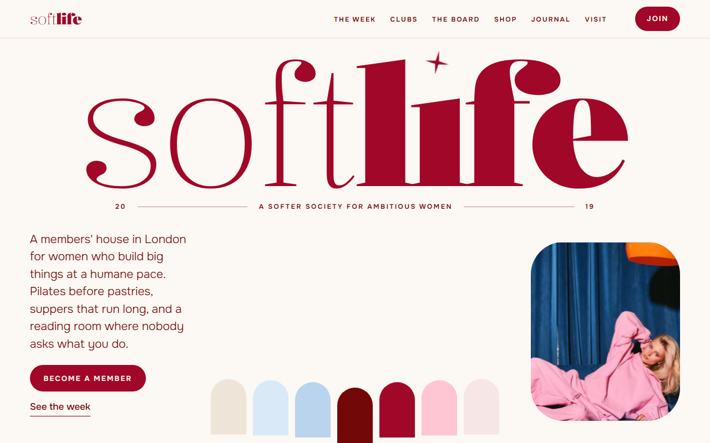
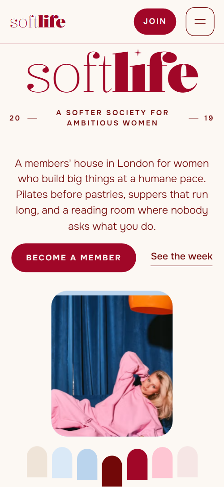
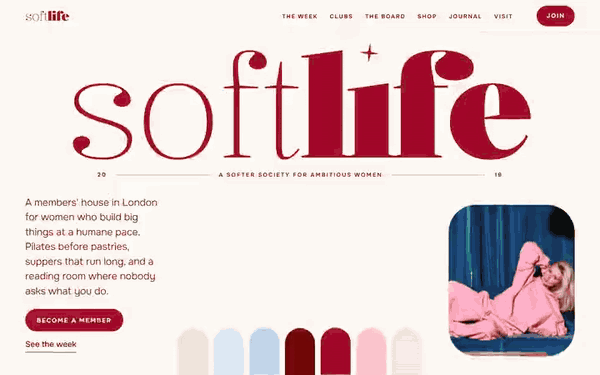

# Free HTML community website template with GSAP scroll animations

Community website template: a one-page site for a members' house, club or network that meets in person, with a seven-day programme, four clubs, a small shop, a journal and three membership tiers. The look is cream, oxblood and pink, with arch-shaped photos and a serif that mixes hairline and bold weights. It is one HTML file with an AGENTS.md, so an AI agent can rewrite it for your own community.

[](LICENSE)  

**[Live demo](https://8bsite.github.io/community-website-template/)** · **[Use this template](https://github.com/new?template_name=community-website-template&template_owner=8bsite)** · **[Download ZIP](https://github.com/8bsite/community-website-template/archive/refs/heads/main.zip)** · **[Template page on 8b.com](https://8b.com/templates/softlife/)**

<a href="https://8bsite.github.io/community-website-template/"></a> <a href="https://8bsite.github.io/community-website-template/"></a>

<p align="center"><a href="https://8bsite.github.io/community-website-template/"></a><br><sub>Scroll animation</sub></p>

## Use it with Claude Code, Cursor or Codex

Download the four files into your project folder (`curl.exe` in Windows PowerShell):

```bash
curl -LO https://raw.githubusercontent.com/8bsite/community-website-template/main/index.html
curl -LO https://raw.githubusercontent.com/8bsite/community-website-template/main/AGENTS.md
curl -LO https://raw.githubusercontent.com/8bsite/community-website-template/main/LICENSE
curl -LO https://raw.githubusercontent.com/8bsite/community-website-template/main/CREDITS.md
```

Then fill in the angle brackets and give your agent this prompt:

```text
Read AGENTS.md, then edit index.html. Rework this into a site for <my community: who it is for, where it meets, opening hours, the weekly programme with days and times, the clubs or groups, membership tiers with prices, perks and terms, anything I sell, how people apply or pay>. Replace first the house name, the programme, the clubs and the tier prices. Keep the section ids, the classes AGENTS.md lists, and the hero beside the manifesto and the letter beside the membership. Set each --len number to its new character count. Ask me for any missing fact and never invent prices, hours, addresses, member numbers, founders, reviews or contacts.
```

Vibe coding this with Claude Code, Cursor or Codex goes faster when the agent gets the real facts first: where the community meets, opening hours, the weekly programme, the clubs, and tier prices with terms such as notice and pausing. It should ask for them and never invent member numbers, a founder or an address. The wordmark is split across tags in the navigation bar, hero and footer, so a plain search for the house name misses the visible letters in all three places. Keep the section ids and listed classes; the week's seven columns and the three tier columns on wide screens, and the moodboard's twelve grid areas, are built for those counts.

No agent? Click **[Use this template](https://github.com/new?template_name=community-website-template&template_owner=8bsite)**, edit `index.html` on GitHub and turn on **Settings > Pages**.

## Sections and motion

- **Navigation**: top bar: wordmark, section links, Join button; phone menu overlay.
- **First screen**: first screen: width-filling two-weight wordmark, tagline, intro, two buttons, portrait, a row of palette chips. Smooth scrolling throughout. Scrolling away, the oxblood arch among the colour chips swells into a full-width dome as the name parts.
- **The softlife principle**: statement on an oxblood ground: the principle in two weights, a founding note and a link. Tied to scroll, the oxblood ground widens, then the statement thickens word by word and its key phrases turn pink.
- **A week, softly**: weekly programme: seven days as seven arch photos, one colour per day. Pinned on desktop, the seven arches rise one by one, their colour drops away and each photo settles from a zoom.
- **Four clubs, one house**: four tiles with a giant initial each: the clubs or programmes (demo: morning, supper, reading, office hours). Bold words in several headings thicken from hairline as they appear; each club tile fades in tilted and settles straight.
- **Things we're soft on**: moodboard collage of twelve tiles: photos, type posters, gingham and stripes. Pinned while you scroll, twelve tiles piled small and tilted in the centre deal out one by one into the collage.
- **The soft edit**: small shop: four products with photo, details, price and Add to bag. On wide screens a photo frame stays beside the list, and from the second product on, its coloured panel and arch photo wipe up into it.
- **Notes from the reading room**: blog: a tall pink poster of two words beside three article entries. Tied to scroll, the two words on the pink poster slide together to the middle, then apart.
- **Dear you,**: founder's letter with a handwritten signature and an arch portrait. The founder's signature inks in from left to right, and the big motto beneath slides away to the right.
- **Join the club**: three membership tiers on cards that turn over (demo: day pass, member, founding circle). Tied to scroll, the heading slides in from the left and the three tier cards turn over one after another.
- **Good questions**: questions and answers (native &lt;details&gt;) beside a heading and an email link.
- **Come over**: address, hours, email, phone and a contact form beside an arch photo of the front door. Two oxblood door leaves over the front-door photo slide open as you scroll, and the photo settles.
- **Footer**: width-filling softlife wordmark, address, hours, contacts, links, copyright and the Design: 8B credit.

## Design

 cream page background  
 text, oxblood ground  
 crimson headings and buttons  
 pink panels and footer  
 blush panels  
 powder blue tiles, gingham  
 pale blue stripes  
 linen behind arch photos

**Kalnia**: headings: serif mixing hairline and bold. **Onest**: light body text, spaced capital labels. **Playwrite US Trad**: handwritten signature and script accent (Google Fonts). Many photos sit in arches with only the upper edge rounded, panels have large soft corners, and the name fills the full width. Most section headings pair a thin phrase with a bold one. The moodboard is a collage of photos, type posters, gingham and stripes, in six columns from 768 px wide and three below.

## Questions

**Can it work as a membership website template with logins and payments?**  
No. It covers the public side only: three tier cards, a shop, a journal and a contact form. There is no login, member area or payment step. The Join button and the tier buttons link to #membership and #contact now, so point each one at your own sign-up or payment page.

**Will the form send anything once I publish the page?**  
No. As shipped, the form asks for a name, an email, what the visitor would like (four options, from a day pass to a private supper) and a note, then checks the fields, shows a thank-you line and resets, sending nothing. Connect Formspree or Netlify Forms, or remove the form and keep the email link. Also edit the promise of a reply within a day.

**Can I remove the shop or the journal?**  
Yes. Delete the section's markup, its styles, its scripts and any links to its id; AGENTS.md lists the steps. The Add to bag buttons are plain buttons with no cart behind them, so a club with nothing to sell is better off without the shop. The journal links point back to the journal until you give them article addresses.

## Is it the right base?

This membership site template is built around a place and a rhythm: a house with a weekly programme, standing clubs and a few paid tiers. If you rent desks and rooms by the day, the [coworking](https://8b.com/templates/isoline/) template explains floors and day passes better. If members need logins, a forum or paid online content, use a platform and keep this file for the public front. The weak spot is everything after the click: there is no login, member area, event calendar or payment step, so each tier button needs your own link.

## Before you publish

- Replace what is marked `data-8b-placeholder` (social preview image, favicon, email, phone, form, social) and the invented demo facts; [AGENTS.md](AGENTS.md) lists them.
- The form sends nothing yet: connect it to Formspree or Netlify Forms, or remove it.

## Tech

GSAP 3.13.0, ScrollTrigger, SplitText, Lenis 1.3.11 from jsDelivr, 132 KB, no build step. Chrome and Edge 111+, Safari 16.2+, Firefox 121+ (it uses color-mix(), container query units, :has(), cascade layers, small/dynamic viewport units). With "reduce motion" on, the page is complete and still.

## License

MIT, see [LICENSE](LICENSE). Photos, fonts and libraries keep their own licences: [CREDITS.md](CREDITS.md). More free templates: [8b.com/templates](https://8b.com/templates/) · [github.com/8bsite](https://github.com/8bsite).
